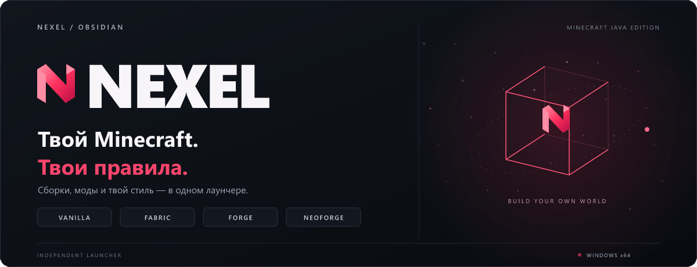
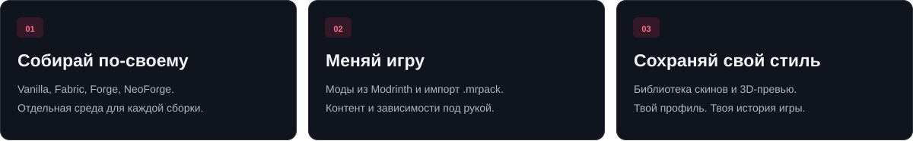
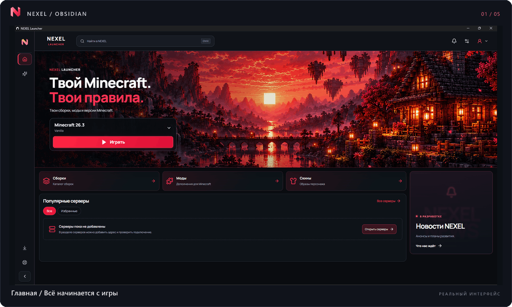
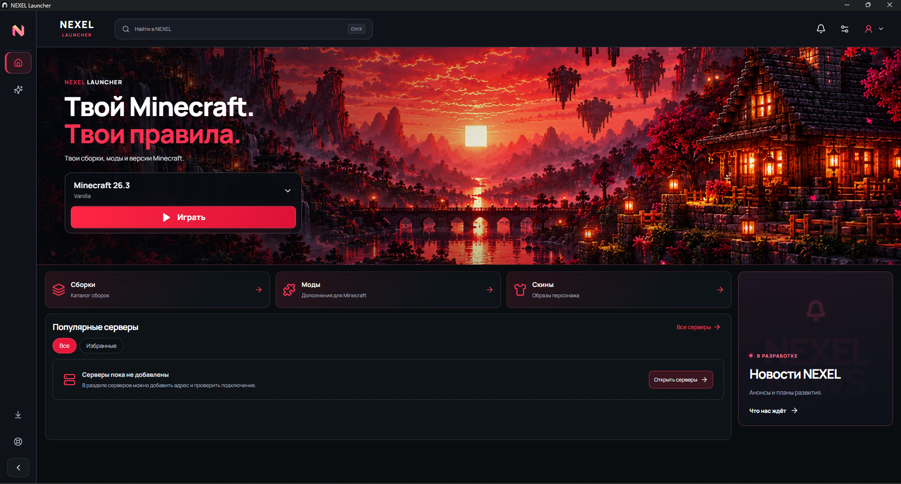
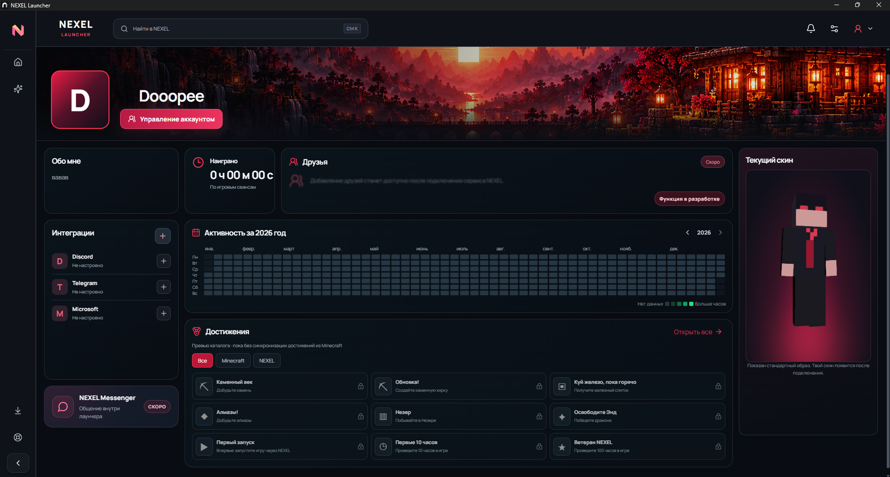
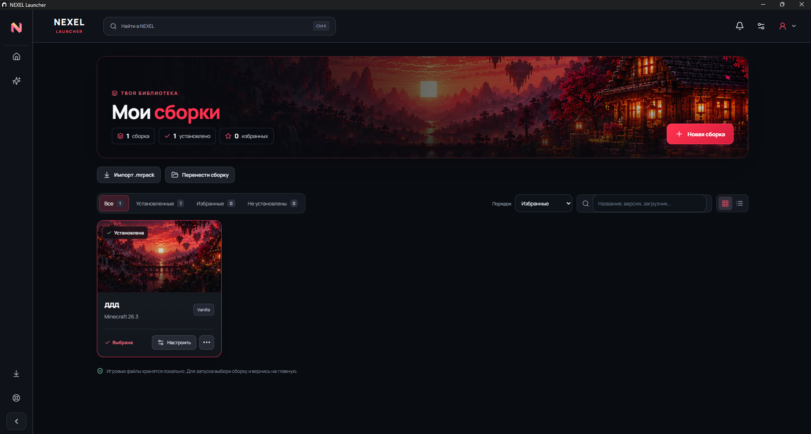
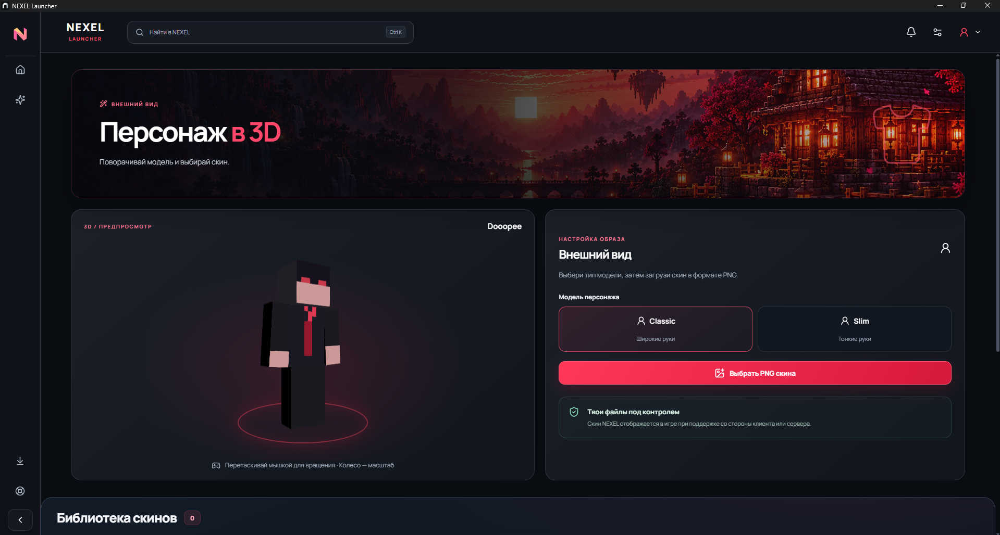
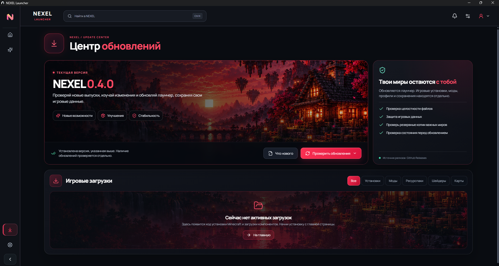
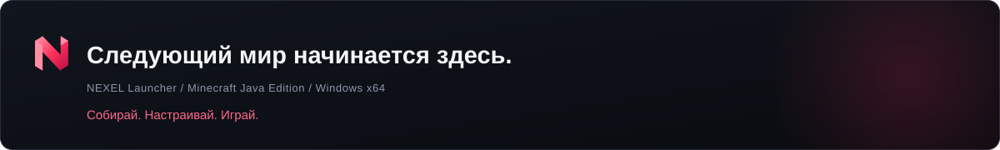

<div align="center">

<a href="https://github.com/Dooopee/NEXEL/releases/latest" title="NEXEL — последняя официальная версия">
  
</a>

<br />

<a href="README.md"></a>
<a href="README_EN.md"></a>

<br /><br />

<a href="https://github.com/Dooopee/NEXEL/releases/latest"></a>
<a href="https://github.com/Dooopee/NEXEL/releases"></a>
<a href="docs/INSTALLATION.md"></a>

<br />

<a href="#технологии-и-принципы"></a>
<a href="#технологии-и-принципы"></a>
<a href="#технологии-и-принципы"></a>
<a href="#технологии-и-принципы"></a>
<a href="#исходный-код-и-правовой-статус"></a>
<a href="#исходный-код-и-правовой-статус"></a>
<a href="https://github.com/Dooopee/NEXEL/commits/main"></a>

<br /><br />

### Твой Minecraft. Твоя сборка. Твои правила.

**NEXEL — независимый лаунчер Minecraft Java Edition для Windows.**  
Одна точка входа для версий игры, модов, сборок, Java, скинов и личного профиля.  
Создан для тех, кто хочет управлять своей игрой — и получать удовольствие от самого процесса.

<br />

<a href="https://github.com/Dooopee/NEXEL/releases/latest"></a>

**[Скачать установщик](https://github.com/Dooopee/NEXEL/releases/latest)** &nbsp; · &nbsp; **[Как установить](docs/INSTALLATION.md)** &nbsp; · &nbsp; **[Все релизы](https://github.com/Dooopee/NEXEL/releases)** &nbsp; · &nbsp; **[Поддержка](SUPPORT.md)**

<sub>Текущий опубликованный выпуск на момент подготовки страницы: <a href="https://github.com/Dooopee/NEXEL/releases/tag/v0.4.2">v0.4.2</a>. Бейдж выше автоматически показывает последнюю опубликованную версию.</sub>

<br /><br />

**[Обзор](#знакомься-nexel)** · **[Возможности](#всё-для-твоей-игры)** · **[Интерфейс](#интерфейс-который-хочется-открывать)** · **[Установка](#первый-запуск-без-лишних-шагов)** · **[Безопасность](#обновления-и-безопасность)** · **[Развитие](#что-дальше)** · **[FAQ](#частые-вопросы)**

</div>

---

## Знакомься, NEXEL

> **Не просто кнопка «Играть». Личное пространство для Minecraft.**

Один день — классическое выживание. Другой — техническая сборка с десятками модов. Третий — исследование нового загрузчика и эксперимент с шейдерами. NEXEL помогает не смешивать всё это в одну папку `.minecraft`.

Он объединяет установку и запуск игры, организацию отдельных сборок, управление контентом и оформление профиля. А визуальная система **Obsidian** делает знакомые действия понятными, собранными и выразительными: тёмная палитра, точная типографика, мягкое движение, минимальный визуальный шум.

<div align="center">
  
</div>

<table>
<tr>
<td width="33%" valign="top">

**01 — Собирай**

Создавай отдельные установки Minecraft, выбирай версию и загрузчик, настраивай каждую сборку независимо.

</td>
<td width="33%" valign="top">

**02 — Меняй**

Ищи контент в Modrinth, работай с модами и их зависимостями, импортируй модпаки `.mrpack`.

</td>
<td width="33%" valign="top">

**03 — Играй по-своему**

Используй локальный профиль, библиотеку скинов и 3D-предпросмотр, возвращайся к выбранной игре.

</td>
</tr>
</table>

## Всё для твоей игры

### Minecraft и сборки

| Возможность | Что это даёт |
| :--- | :--- |
| **Vanilla** | Оригинальная Minecraft Java Edition в выбранной версии. |
| **Fabric** | Сборки с Fabric-экосистемой модов и совместимым загрузчиком. |
| **Forge** | Установка Forge для поддерживаемых им версий игры. |
| **NeoForge** | Отдельный вариант модлоадера для совместимых версий Minecraft. |
| **Изолированные установки** | Свои игровые директории, компоненты и настройки для каждой сборки. |
| **Управление сборками** | Создание, выбор, настройка и клонирование. |
| **Импорт `.mrpack`** | Установка модпаков в поддерживаемом формате Modrinth. |
| **Java и память** | Подбор среды Java, настройка RAM и параметров запуска. |

**Важно:** конкретная пара «Minecraft + загрузчик» должна быть совместима. Поддержка нескольких загрузчиков не означает, что один и тот же мод подходит для всех них.

### Контент и персонализация

| Направление | Что доступно |
| :--- | :--- |
| **Modrinth** | Поиск модов и подходящих версий для выбранной сборки. |
| **Зависимости** | Подготовка зависимостей для поддерживаемых установочных сценариев. |
| **Управление модами** | Просмотр компонентов сборки, включение, отключение и удаление. |
| **Скины** | Локальная коллекция PNG-скинов, варианты Classic и Slim. |
| **3D-персонаж** | Предпросмотр выбранного образа в объёме. |
| **NEXEL ID** | Локальный профиль игрока, настройки оформления, игровое время и активность. |
| **Microsoft** | Отдельное подключение официального аккаунта, когда оно требуется для лицензированной игры и серверов. |

**Границы возможностей:** NEXEL ID в опубликованной версии не является облачным аккаунтом. Универсальная видимость локальных скинов другим игрокам на всех серверах не гарантируется. Синхронизация достижений Minecraft пока не подключена.

## Интерфейс, который хочется открывать

**Obsidian** — единая визуальная система NEXEL: сдержанный чёрный фон, контрастные элементы, акцентный цвет и продуманная структура. Здесь у каждого экрана есть задача, а не просто место в меню.

<div align="center">
  <a href="docs/screenshots/01-home.png" title="Открыть реальный скриншот главной NEXEL">
    
  </a>
  <sub>Анимация собрана из реальных кадров NEXEL. Нажми, чтобы открыть главную страницу в полном размере.</sub>
</div>

<br />

<details>
<summary><b>01 / Главная — пространство перед запуском</b></summary>
<br />

Главная объединяет выбор сборки, основную точку запуска, новости и быстрые переходы к контенту. Её задача — не заставлять игрока искать привычное действие в нескольких местах.


</details>

<details>
<summary><b>02 / Профиль — характер игрока в деталях</b></summary>
<br />

Локальный профиль с персональным оформлением, историей игрового времени, календарём активности и визуализацией скина. Блок достижений — превью каталога, а не готовая синхронизация прогресса Minecraft.


</details>

<details>
<summary><b>03 / Сборки — порядок вместо хаоса</b></summary>
<br />

Отдельные игровые пространства помогают экспериментировать с версиями Minecraft, Fabric, Forge и NeoForge, не смешивая наборы модов и файлов.


</details>

<details>
<summary><b>04 / Скины — твой персонаж, твой стиль</b></summary>
<br />

Библиотека изображений PNG, поддержка моделей Classic и Slim и объёмный предпросмотр позволяют подобрать образ прямо в лаунчере.


</details>

<details>
<summary><b>05 / Центр обновлений — контроль над каждой загрузкой</b></summary>
<br />

Информация о версии, статус загрузки и проверка обновлений — в одном месте. На историческом скриншоте может отображаться версия, отличающаяся от последнего публичного выпуска.


</details>

<sub>Визуальные материалы показывают реальные экраны, зафиксированные для ранних выпусков. Интерфейс и доступность отдельных функций могут отличаться между версиями; ориентируйся на примечания конкретного релиза.</sub>

## Первый запуск без лишних шагов

**NEXEL распространяется как готовое приложение для Windows x64.** Для установки не нужны исходники, Node.js, pnpm или инструменты разработчика.

1. **Открой [последний релиз](https://github.com/Dooopee/NEXEL/releases/latest).** Прочитай его описание и совместимость.
2. **Скачай EXE-установщик** с обозначением `windows-x64-setup`. ZIP в этом выпуске содержит установщик, а **не portable-приложение**.
3. **Проверь файл**, если требуется: сравни SHA-256 с `SHA256SUMS.txt` из того же релиза.
4. **Установи NEXEL** обычным способом и открой приложение.
5. **Создай локальный профиль NEXEL ID** или подключи нужную учётную запись.
6. **Выбери Minecraft**, создай сборку с Vanilla / Fabric / Forge / NeoForge или импортируй `.mrpack`.
7. **Дождись установки компонентов**, добавь совместимые моды при необходимости и нажми **«Играть»**.

<div align="center">

**[Установка и обновление — подробно](docs/INSTALLATION.md)** &nbsp; · &nbsp; **[Проверка загруженных файлов](docs/SECURITY.md)** &nbsp; · &nbsp; **[Ответы на вопросы](docs/FAQ.md)**

</div>

### Скачивание NEXEL 0.4.2

| Файл | Назначение |
| :--- | :--- |
| **[Windows x64 Setup.exe](https://github.com/Dooopee/NEXEL/releases/download/v0.4.2/NEXEL-0.4.2-windows-x64-setup.exe)** | Официальный установщик опубликованной версии 0.4.2. |
| [Windows ZIP](https://github.com/Dooopee/NEXEL/releases/download/v0.4.2/NEXEL-0.4.2-Windows.zip) | Архив с установщиком; **не portable**. |
| [SHA256SUMS.txt](https://github.com/Dooopee/NEXEL/releases/download/v0.4.2/SHA256SUMS.txt) | Контрольные суммы файлов этого выпуска. |
| [Отчёт о тестировании](https://github.com/Dooopee/NEXEL/releases/download/v0.4.2/TEST_REPORT_RU.md) | Объём проверок и известные ограничения выпуска. |
| [Все версии NEXEL](https://github.com/Dooopee/NEXEL/releases) | История выпусков и их изменений. |

Для новой версии используй **[страницу последнего релиза](https://github.com/Dooopee/NEXEL/releases/latest)**, а не ссылки на конкретный старый установщик.

### Требования и совместимость

| Параметр | Уточнение |
| :--- | :--- |
| **Платформа** | Windows x64. macOS, Linux и мобильные сборки публично не заявлены. |
| **Интернет** | Нужен для первоначальных загрузок игры, Java и компонентов. |
| **Java** | Нужная версия зависит от Minecraft; NEXEL умеет подбирать среду автоматически. |
| **RAM и видеокарта** | Зависит от версии Minecraft, модов, шейдеров и выбранных настроек. |
| **Свободное место** | Зависит от числа установок, миров, модов и кэша. |
| **Minecraft-аккаунт** | Для лицензированной игры и многих серверов необходим соответствующий официальный аккаунт. Локальный NEXEL ID его не заменяет. |

## Обновления и безопасность

Запускать установщик — это доверять ему свои файлы. Поэтому механизм обновления NEXEL проектируется вокруг **проверяемой целостности** и сохранения пользовательских данных.

```text
GitHub Releases
      |
      v
Подписанный nexel-update.json
      |
      v
Проверка подписи Ed25519
      |
      v
Скачивание установщика
      |
      v
Сверка размера и SHA-256
      |
      v
Установка с учётом совместимости
```

- **Ed25519** служит для проверки подписанного манифеста обновления.
- **SHA-256** позволяет сверить скачанный файл с ожидаемой контрольной суммой.
- **Отдельные игровые данные** помогают не смешивать файлы игры с установленной программой.
- **Резервные копии миров** остаются разумной мерой перед обновлением игры, сменой модлоадера или изменением набора модов.
- **Приватный исходный код** не размещён в публичном репозитории с установщиками.

> **Примечание о подписи Windows.** На текущем публичном выпуске отсутствует Windows Authenticode-подпись EXE. Ed25519-проверка манифеста не заменяет Authenticode, антивирусную проверку или резервное копирование. Если происхождение файла вызывает сомнения, не отключай защиту Windows и не запускай его.

**[Руководство по безопасности](docs/SECURITY.md)** · **[Отчёты и контрольные суммы в релизах](https://github.com/Dooopee/NEXEL/releases)**

## Что дальше

Проект развивается поэтапно. Здесь важно различать функции, уже представленные в приложении, и направления, которые ещё только создаются.

| Направление | Статус | Состояние |
| :--- | :--- | :--- |
| Версии Minecraft, Vanilla / Fabric / Forge / NeoForge | **Реализовано** | Выбор и установка поддерживаемых конфигураций. |
| Изолированные сборки, `.mrpack`, моды, Java | **Реализовано** | Доступно в приложении с ограничениями конкретных версий и источников. |
| Локальный NEXEL ID, скины, игровая активность | **Реализовано** | Локальные данные без облачной синхронизации. |
| Центр обновлений с Ed25519 / SHA-256 | **Реализовано** | Текущие публичные выпуски используют проверяемые обновления. |
| Друзья и NEXEL Messenger | **В разработке** | Не следует воспринимать интерфейсные элементы как готовую социальную сеть. |
| Облачный NEXEL ID и синхронизация | **В разработке** | Универсальная облачная авторизация пока не подключена. |
| NEXEL Studio и расширенные новости | **В разработке** | Возможности развиваются и уточняются. |
| Общий каталог серверов | **Планируется** | Централизованная база для всех пользователей ещё не подтверждена как готовая. |
| Облачные достижения и персональная экосистема | **Планируется** | Нет объявленной даты выпуска. |

**[Развёрнутая дорожная карта](docs/ROADMAP.md)**. Планы не являются обещанием конкретных сроков или наличия функции в опубликованной версии.

## Частые вопросы

<details>
<summary><b>Можно ли играть без отдельного NEXEL ID или Microsoft?</b></summary>
<br />

NEXEL ID — локальный профиль лаунчера. Он не выдаёт лицензию Minecraft. Для игры и серверов, где требуется проверка владения Minecraft, используй соответствующий официальный Microsoft-аккаунт.

</details>

<details>
<summary><b>Где находятся мои миры и сборки?</b></summary>
<br />

Игровые данные хранятся отдельно от установленной программы. Не удаляй папку пользовательских данных при переустановке. Перед рисковыми изменениями всегда сохраняй отдельную копию важных миров.

</details>

<details>
<summary><b>Будут ли работать любые моды с любым загрузчиком?</b></summary>
<br />

Нет. Мод должен подходить и для версии Minecraft, и для Fabric / Forge / NeoForge. Доступность совместимого варианта зависит от автора мода и его дистрибуции.

</details>

<details>
<summary><b>Может ли NEXEL импортировать существующий модпак?</b></summary>
<br />

Поддерживается импорт `.mrpack`. Установка может требовать подключения к интернету и доступа к исходным файлам модпака.

</details>

<details>
<summary><b>Синхронизируется ли мой профиль между компьютерами?</b></summary>
<br />

Пока нет. NEXEL ID в текущем приложении локальный. Облачные функции находятся в разработке и не должны восприниматься как доступные.

</details>

<details>
<summary><b>Увидят ли все игроки мой локальный скин?</b></summary>
<br />

Не обязательно. Отображение скина у других игроков зависит от возможностей клиента и сервера. Внешний вид в 3D-превью самого лаунчера не означает универсальную поддержку в мультиплеере.

</details>

<details>
<summary><b>Почему Windows предупреждает об установщике?</b></summary>
<br />

У опубликованного установщика нет Windows Authenticode-подписи. Сверяй источник и SHA-256 с официальным релизом; не отключай защиту Windows ради установки.

</details>

<details>
<summary><b>Исходный код открыт? Это MIT?</b></summary>
<br />

Нет. Данный репозиторий — публичная витрина и канал доставки готовых выпусков, а исходники лаунчера хранятся отдельно и не опубликованы. Для этого публичного репозитория GitHub на момент подготовки страницы не определял лицензию. Бейджи TypeScript / Electron / React описывают технологии приложения, а не лицензию или состав исходников здесь.

</details>

<details>
<summary><b>Как правильно сообщить об ошибке?</b></summary>
<br />

Укажи версию NEXEL и Windows, версию Minecraft / модлоадера, шаги воспроизведения и точный текст ошибки. Проверь вложения на наличие токенов, email, приватных серверов и других персональных данных. [Подробная инструкция](SUPPORT.md).

</details>

**Больше ответов — в [полном FAQ](docs/FAQ.md).**

## Технологии и принципы

NEXEL создан с использованием **Electron, React, TypeScript, Vite** и инструментов экосистемы Minecraft, включая **XMCL**. Стек и инструменты используются в приватном исходном проекте; публичный репозиторий содержит документацию, медиафайлы и готовые установщики.

Мы считаем важными следующие принципы:

- **Работоспособность раньше декоративности.** Любой элемент интерфейса должен помогать реальному сценарию игрока.
- **Уважение к данным.** Миры, аккаунты, сборки и настройки нельзя приносить в жертву внешнему виду.
- **Совместимость.** Изменения не должны необоснованно ломать старые установки и обновления.
- **Прозрачность статусов.** Реализованное отделяется от разрабатываемого, а концепции — от работающих функций.
- **Качество интерфейса.** Единая типографика, предсказуемая навигация, аккуратные состояния и внимание к деталям.

## Разработчик и сообщество

<table>
<tr>
<td width="50%" valign="top">

### Сообщить об ошибке

Нашёл проблему установки, запуска Minecraft или работы интерфейса? Напиши, что произошло, как повторить ошибку и какая версия установлена.

**[Создать Bug Report](https://github.com/Dooopee/NEXEL/issues/new?template=bug_report.yml)**

</td>
<td width="50%" valign="top">

### Предложить идею

Знаешь, как сделать NEXEL полезнее? Опиши конкретный сценарий и желаемый результат — это помогает выбирать правильные приоритеты.

**[Предложить функцию](https://github.com/Dooopee/NEXEL/issues/new?template=feature_request.yml)**

</td>
</tr>
</table>

**[Обсуждения](https://github.com/Dooopee/NEXEL/discussions)** · **[Техническая поддержка](SUPPORT.md)** · **[История версий](https://github.com/Dooopee/NEXEL/releases)** · **[Автор — Dooopee](https://github.com/Dooopee)**

Если проект оказался полезным, можешь поставить **Star** на GitHub. Это помогает другим игрокам находить NEXEL.

## Исходный код и правовой статус

**NEXEL — независимый продукт.** Он не является официальным лаунчером и не связан с Mojang Studios, Microsoft или владельцами упоминаемых сторонних проектов. Minecraft, названия платформ, логотипы и товарные знаки принадлежат соответствующим правообладателям.

- Этот репозиторий служит для презентации, документации, сообщений об ошибках и распространения **готовых выпусков**.
- **Исходный код приложения закрыт** и здесь не размещён. Публикация установщика не означает публикацию исходного кода.
- Репозиторий не следует считать лицензированным по MIT только потому, что в приложении используется TypeScript. Отдельная лицензия на материалы репозитория сейчас не указана; права на использование определяются применимым законодательством и явно опубликованными разрешениями правообладателей.
- **Не загружай в Issues** персональные миры, пароли, токены, ключи доступа или полные зашифрованные хранилища аккаунтов.

---

<div align="center">

<a href="https://github.com/Dooopee/NEXEL/releases/latest"></a>

**[Скачать NEXEL](https://github.com/Dooopee/NEXEL/releases/latest)** · **[Вопросы и ответы](docs/FAQ.md)** · **[Поддержать идеей](https://github.com/Dooopee/NEXEL/discussions)** · **[English](README_EN.md)**

<sub>Made by <a href="https://github.com/Dooopee">Dooopee</a> · Independently developed · Windows x64 · Minecraft Java Edition</sub>

</div>