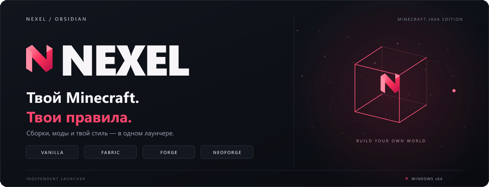
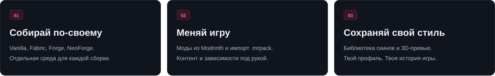
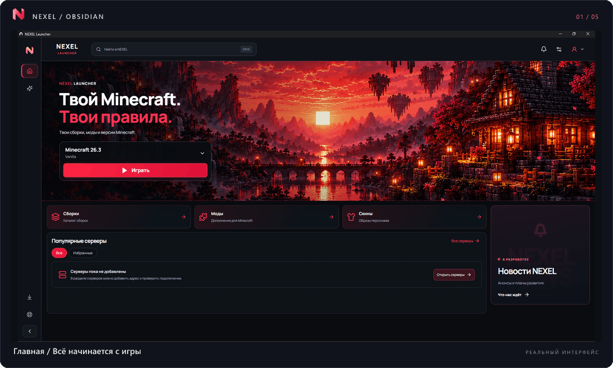
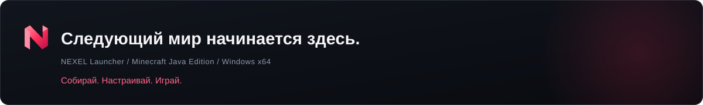

 

 

**Независимый лаунчер Minecraft Java Edition.** 
Изолированные сборки, любимые моды и твой персонаж — в одном пространстве.

**[Все версии](https://github.com/Dooopee/NEXEL/releases)** &nbsp; · &nbsp; **[Установка](docs/INSTALLATION.md)** &nbsp; · &nbsp; **[Вопросы и ответы](docs/FAQ.md)**

[Возможности](#возможности) · [Интерфейс](#внутри-nexel) · [Быстрый старт](#от-установки-до-первого-мира) · [Планы](docs/ROADMAP.md) · [Обратная связь](SUPPORT.md)

---

## Minecraft, который ты собираешь сам

Один мир — для спокойного выживания. Другой — для большой сборки с друзьями. Третий — для экспериментов с модами. **NEXEL помогает держать их в порядке:** выбирать версии, управлять контентом и возвращаться в нужную сборку из единого интерфейса.

Оформление **Obsidian** объединяет тёмные поверхности, розовые акценты и крупные игровые сцены. За визуальным стилем — практичные инструменты: установка Java, управление загрузчиками, библиотека скинов и центр обновлений.

## Возможности

| Пространство | Что умеет NEXEL |
| :--- | :--- |
| **Сборки** | Отдельные установки Minecraft со своими версиями и контентом; создание сборок и импорт `.mrpack`. |
| **Загрузчики** | Установка Vanilla, Fabric, Forge и NeoForge. Доступность конкретной версии зависит от выбранного загрузчика. |
| **Моды** | Поиск в Modrinth, установка зависимостей и управление компонентами выбранной сборки. |
| **Java** | Подбор и установка среды Java для выбранной версии Minecraft. |
| **Скины** | Локальная библиотека PNG, модели Classic / Slim и интерактивный предпросмотр персонажа в 3D. |
| **Профиль** | Локальный NEXEL ID, оформление, учёт игрового времени и календарь активности. |
| **Обновления** | Проверка новой версии, загрузка с прогрессом и проверка подписи Ed25519 и контрольной суммы SHA-256 перед установкой. |

**NEXEL ID — локальный профиль.** Облачная синхронизация пока не подключена; email необязателен и не подтверждается письмом. Microsoft подключается отдельно для лицензированной игры и серверов, которым он необходим. Подробности — в [FAQ](docs/FAQ.md#аккаунты-и-профиль).

## Внутри NEXEL

Пять экранов, одно визуальное пространство. Анимированный обзор последовательно показывает главную, профиль, сборки, скины и центр обновлений.

<b>01 / Главная — твой следующий запуск</b>

Выбор сборки, запуск игры и переход к основным разделам.

<b>02 / Профиль — твой стиль и история</b>

Оформление, игровое время, календарь активности и предпросмотр скина. Достижения на этом экране представлены как превью каталога; синхронизация достижений Minecraft не подключена.

<b>03 / Сборки — каждому миру своё пространство</b>

Библиотека отдельных установок, поиск и быстрый переход к настройкам выбранной сборки.

<b>04 / Скины — образ с любого ракурса</b>

Локальная библиотека, выбор Classic / Slim и просмотр модели в 3D. Видимость скина другим игрокам зависит от поддержки со стороны клиента и сервера.

<b>05 / Обновления — всё под контролем</b>

Проверка версии лаунчера и управление загрузками из отдельного центра.

В галерее использованы пять кадров, предоставленных владельцем проекта. На экране центра обновлений показана версия 0.4.0. Актуальная версия и список изменений всегда доступны в <a href="https://github.com/Dooopee/NEXEL/releases/latest">последнем выпуске</a>. <a href="docs/assets/nexel-hero.svg">Неподвижная обложка</a>.

## От установки до первого мира

1. **Скачай.** Открой [последний выпуск](https://github.com/Dooopee/NEXEL/releases/latest) и выбери установщик `Windows x64 Setup.exe`.
2. **Установи.** Запусти установщик и выбери папку программы.
3. **Создай профиль.** При первом запуске зарегистрируй локальный NEXEL ID или войди в существующий.
4. **Собери свою игру.** Создай сборку или импортируй `.mrpack`, выбери версию Minecraft и нужный загрузчик.
5. **Играй.** Установи компоненты и нажми **«Играть»**. Обновления самого лаунчера доступны в центре обновлений.

**Платформа выпуска — Windows x64.** Нужны подключение к интернету для загрузок и свободное место для игры. Требования к Java, оперативной памяти и видеокарте зависят от версии Minecraft и модов.

ZIP из релиза содержит тот же установщик; это **не portable-версия**. Миры, сборки и настройки хранятся отдельно от программы. Перед важными изменениями сохраняй резервные копии ценных миров.

**[Подробная установка и обновление →](docs/INSTALLATION.md)**

## Обновления, которым есть что проверить

Встроенный механизм обновления проверяет **Ed25519-подпись манифеста**, затем размер и **SHA-256 установщика**. Центр обновлений показывает ход загрузки и выполняет переход к установке. К выпускам прилагаются контрольные суммы и отчёты о проверках.

| Что проверить | Где посмотреть |
| :--- | :--- |
| Актуальную версию и изменения | [Последний выпуск](https://github.com/Dooopee/NEXEL/releases/latest) |
| Целостность загруженного файла | `SHA256SUMS.txt` в файлах соответствующего релиза |
| Объём проведённых проверок | `TEST_REPORT_RU.md` и отчёт публичной загрузки в релизе, если приложены |
| Совместимость старой установки | Инструкция соответствующего выпуска и [руководство по установке](docs/INSTALLATION.md#обновление-старой-версии) |

У приложения пока нет **Windows Authenticode-подписи**. Подпись обновлений Ed25519 — отдельный механизм и не заменяет сертификат подписи EXE. [Подробнее о проверке файлов →](docs/SECURITY.md)

## Что дальше

NEXEL развивается вокруг одной идеи: собрать запуск игры, контент и личное пространство в цельный продукт.

| Направление | Текущий статус |
| :--- | :--- |
| Сборки, загрузчики, моды, Java, скины и локальный профиль | Реализованы в приложении |
| Центр обновлений с проверкой подписи и хеша | Реализован |
| Друзья и NEXEL Messenger | В разработке |
| Облачные интеграции и синхронизация | В разработке; подключение к работающему приложению не завершено |
| Новости и Studio | В разработке |
| Достижения | Превью каталога |

Даты выхода будущих функций не объявлены. Раздел поддержки сейчас содержит локальные справочные инструменты; онлайн-оператор не подключён. [Планы и границы текущей версии →](docs/ROADMAP.md)

## Технологии

Приложение построено на **TypeScript, Electron и React**; сборка интерфейса использует **Vite**, а Minecraft-компоненты — библиотеки **XMCL**. Эти технологии относятся к самому лаунчеру. Здесь размещены публичная страница продукта, документация, изображения и готовые выпуски; исходный код приложения в этот репозиторий не включён.

## На связи

Нашёл ошибку, придумал полезную функцию или хочешь обсудить NEXEL? Выбери подходящий раздел — шаблоны помогут собрать нужную информацию.

| Задача | Куда перейти |
| :--- | :--- |
| Сообщить об ошибке | [Создать отчёт](https://github.com/Dooopee/NEXEL/issues/new?template=bug_report.yml) |
| Предложить функцию | [Описать идею](https://github.com/Dooopee/NEXEL/issues/new?template=feature_request.yml) |
| Обсудить проект | [Discussions](https://github.com/Dooopee/NEXEL/discussions) |
| Найти ответ или подготовить логи | [FAQ](docs/FAQ.md) · [Поддержка](SUPPORT.md) |

Если NEXEL оказался полезен, поддержи проект **звездой на GitHub** — так его проще найти другим игрокам.

 

Создатель — <a href="https://github.com/Dooopee">Dooopee</a> · NEXEL — независимый проект, не являющийся официальным продуктом Mojang или Microsoft.

