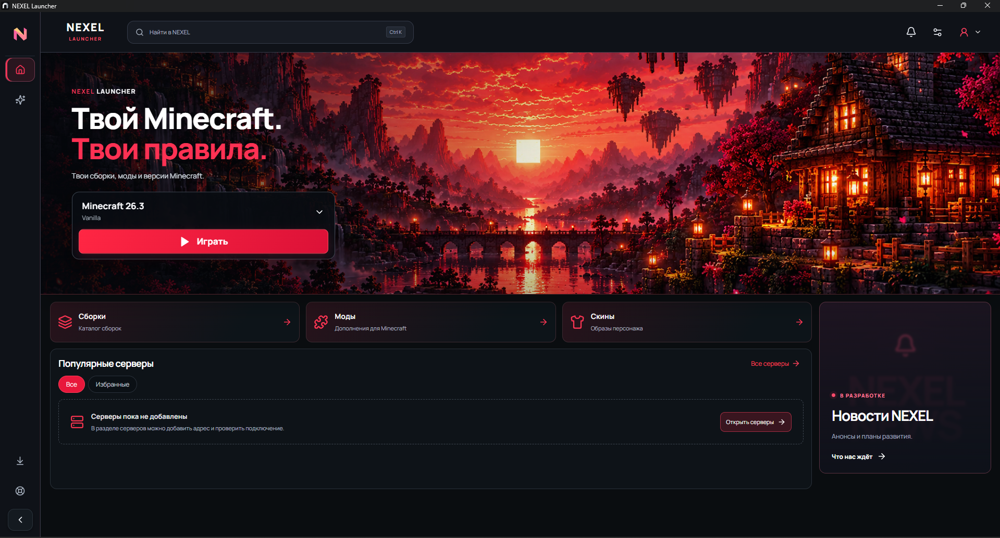
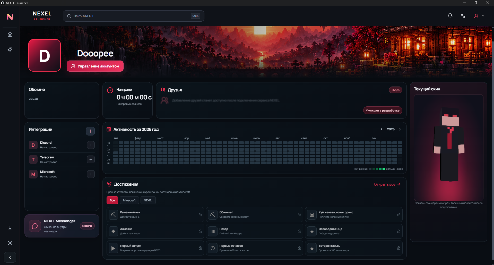
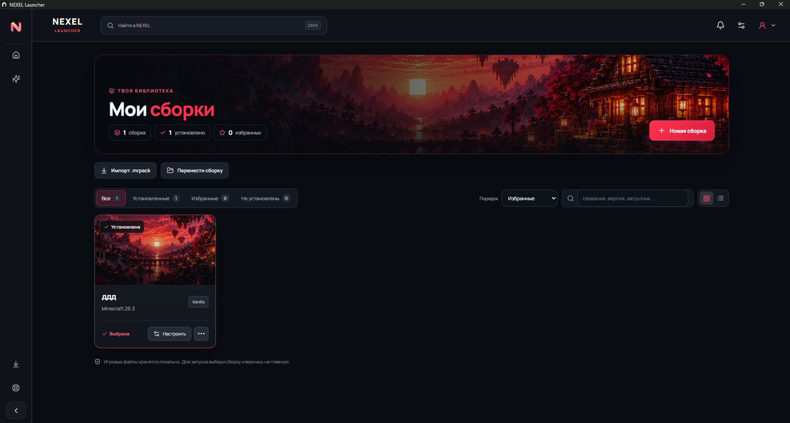
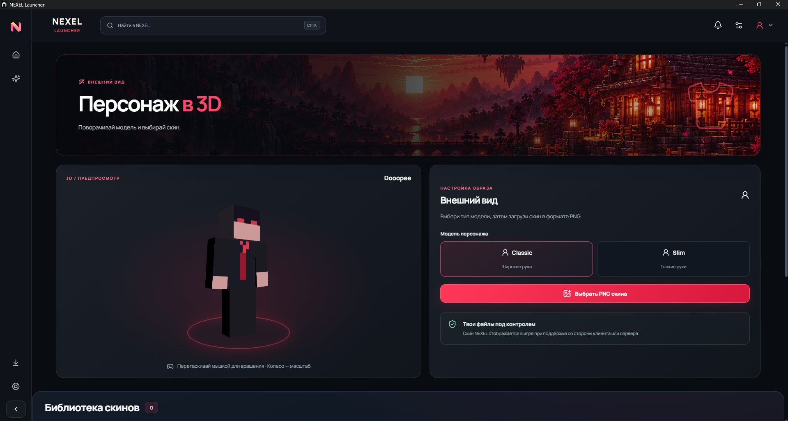
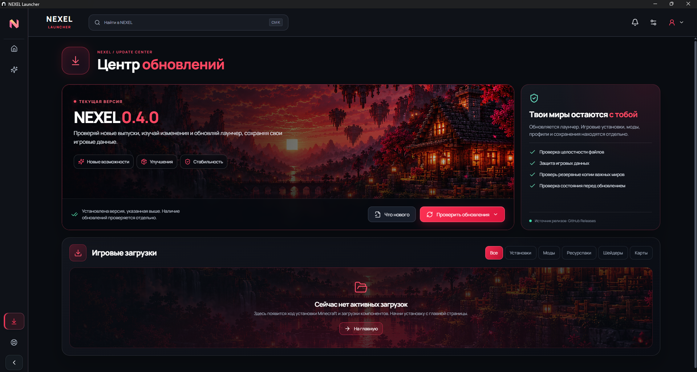

# NEXEL Launcher
### Твой Minecraft. Твои правила.

**Windows x64 · Minecraft Java Edition · NEXEL Obsidian**

## [⬇ Скачать NEXEL для Windows](https://github.com/Dooopee/NEXEL/releases/latest)

[История версий](https://github.com/Dooopee/NEXEL/releases) · [Сообщить об ошибке](https://github.com/Dooopee/NEXEL/issues)

NEXEL — независимый лаунчер Minecraft Java Edition: изолированные сборки, моды и скины в одном пространстве. Репозиторий служит публичной витриной и местом распространения готовых выпусков.

| Твоё пространство | Что доступно |
| --- | --- |
| **Сборки** | Отдельные установки Vanilla, Fabric, Forge и NeoForge, импорт .mrpack, управление версиями |
| **Моды** | Поиск Modrinth, установка зависимостей, управление компонентами сборки |
| **Скины** | Библиотека PNG, выбор Classic / Slim и предпросмотр персонажа в 3D |
| **Профиль** | Локальный NEXEL ID, оформление профиля, журнал игрового времени и активности |
| **Java** | Подбор и установка среды для выбранной версии Minecraft |
| **Обновления** | Проверка выпусков, загрузка и установка из центра обновлений с проверкой Ed25519 и SHA-256 |

Видимость скина NEXEL другим игрокам зависит от поддержки со стороны клиента и сервера. NEXEL ID хранится на компьютере; это пока не облачный аккаунт. Почта необязательна и не подтверждается письмом. Microsoft подключается отдельно для лицензированной игры и серверов, которым он необходим.

### Начать играть

1. Открой [последний выпуск](https://github.com/Dooopee/NEXEL/releases/latest) и скачай Windows Setup.exe.
2. Запусти установщик и выбери папку программы. ZIP в релизе содержит тот же установщик — это **не portable-версия**.
3. При первом запуске создай NEXEL ID или войди в существующий профиль.
4. Создай или импортируй сборку, выбери версию Minecraft и установи компоненты.
5. Нажми «Играть». Для последующих обновлений используй центр обновлений внутри NEXEL.

Миры, сборки и настройки хранятся отдельно от программы. Перед важными изменениями сохраняй резервную копию ценных миров. Проверенная платформа выпуска — Windows x64; требования к Java и памяти зависят от версии Minecraft и модов.

### Твой профиль

Оформление, игровое время, календарь активности и предпросмотр скина. Достижения на этом экране — превью каталога, без синхронизации достижений Minecraft.

<b>Мои сборки — открыть скриншот</b>

Изолированные установки, поиск и быстрый переход к настройкам сборки.

<b>Скины и персонаж в 3D — открыть скриншот</b>

Предпросмотр модели, Classic / Slim и локальная библиотека скинов.

<b>Центр обновлений — открыть скриншот</b>

Управление версией лаунчера и игровые загрузки. Пять кадров предоставлены владельцем проекта; на кадре центра показана версия 0.4.0. Текущий выпуск всегда доступен по ссылке выше.

### Сейчас в разработке

NEXEL Messenger, друзья, облачные интеграции, новости и Studio. Эти экраны обозначают планы развития. Поддержка пока содержит локальные справочные инструменты; онлайн-оператор не подключён.

### Проверка и безопасность

Релиз содержит контрольные суммы и отчёт о проверках. Встроенный updater принимает подписанный `nexel-update.json` и проверяет установщик перед запуском. Программа пока не имеет подписи Windows Authenticode; Ed25519-подпись обновлений — отдельный механизм. Подробности и границы тестирования указаны в каждом [выпуске](https://github.com/Dooopee/NEXEL/releases).

NEXEL не является официальным продуктом Mojang или Microsoft.
