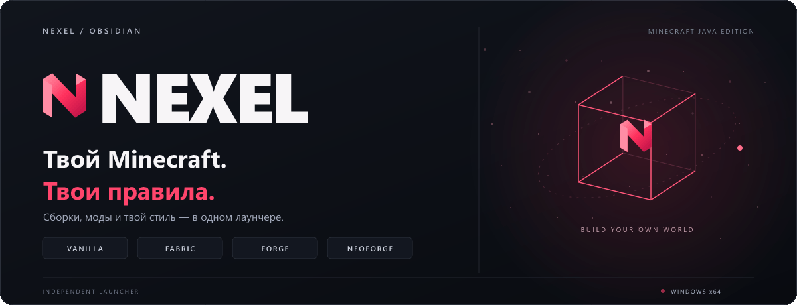
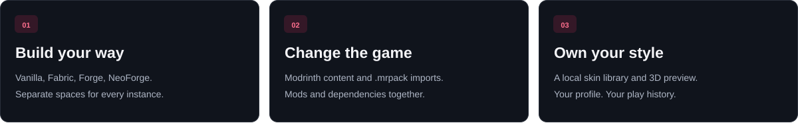
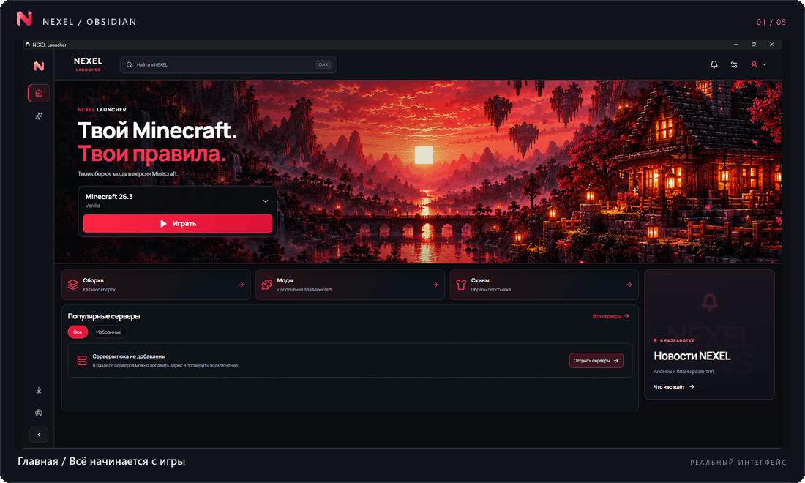
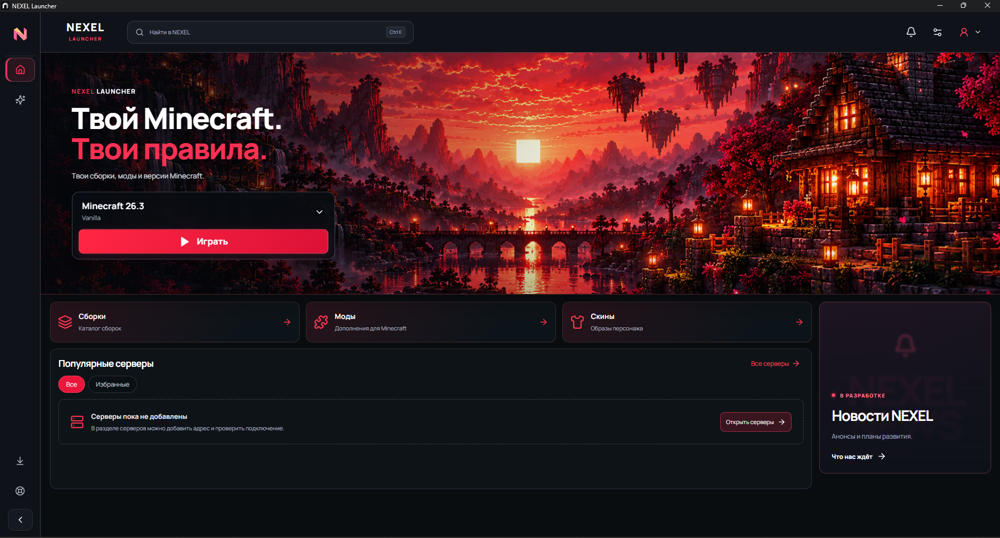
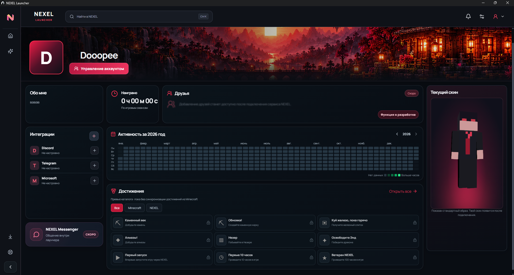
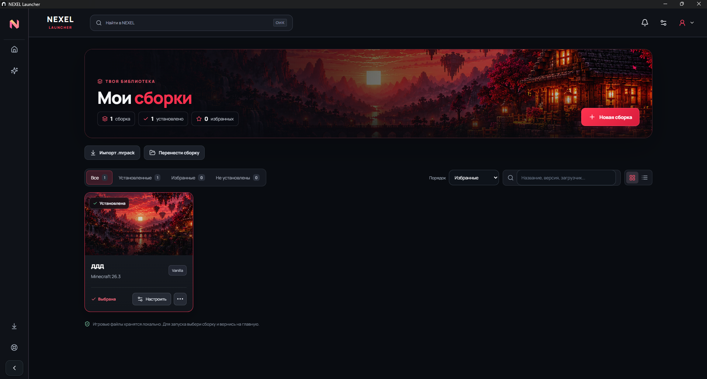
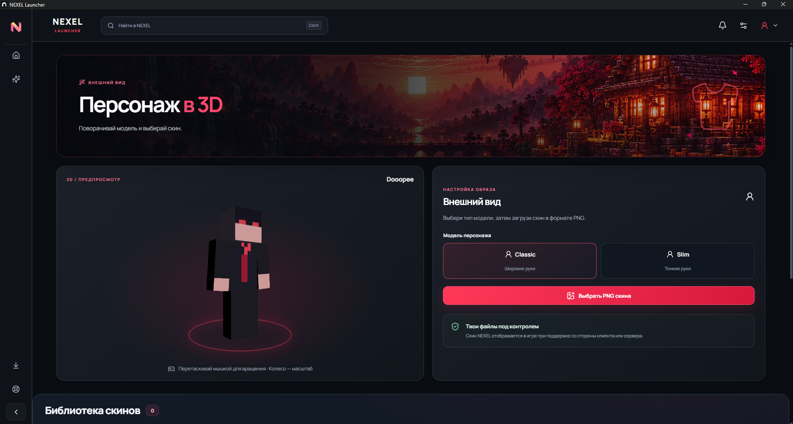
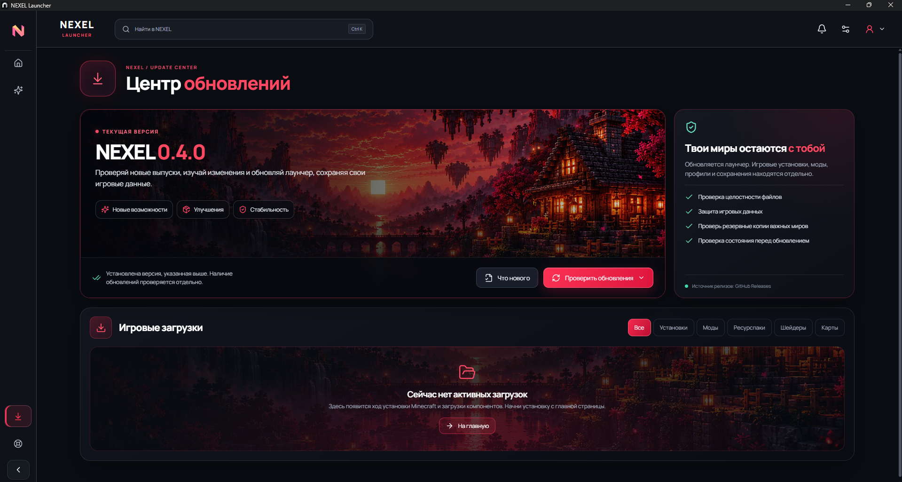
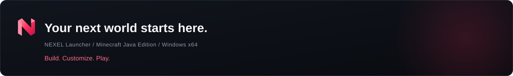

<div align="center">

<a href="https://github.com/Dooopee/NEXEL/releases/latest" title="NEXEL — latest official release">
  
</a>

<br />

<a href="README.md"></a>
<a href="README_EN.md"></a>

<br /><br />

<a href="https://github.com/Dooopee/NEXEL/releases/latest"></a>
<a href="https://github.com/Dooopee/NEXEL/releases"></a>
<a href="docs/INSTALLATION.md"></a>

<br />

<a href="#technology-and-design-principles"></a>
<a href="#technology-and-design-principles"></a>
<a href="#technology-and-design-principles"></a>
<a href="#technology-and-design-principles"></a>
<a href="#source-code-and-legal-notice"></a>
<a href="#source-code-and-legal-notice"></a>
<a href="https://github.com/Dooopee/NEXEL/commits/main"></a>

<br /><br />

### Your Minecraft. Your setup. Your rules.

**NEXEL is an independent Minecraft Java Edition launcher for Windows.**  
A single home for game versions, modded instances, Java, skins, and your personal profile.  
Designed for players who want more control over how they play — without sacrificing a refined experience.

<br />

<a href="https://github.com/Dooopee/NEXEL/releases/latest"></a>

**[Download installer](https://github.com/Dooopee/NEXEL/releases/latest)** &nbsp; · &nbsp; **[Installation](docs/INSTALLATION.md)** &nbsp; · &nbsp; **[All releases](https://github.com/Dooopee/NEXEL/releases)** &nbsp; · &nbsp; **[Support](SUPPORT.md)**

<sub>Latest published version verified while preparing this page: <a href="https://github.com/Dooopee/NEXEL/releases/tag/v0.4.2">v0.4.2</a>. The badge above updates to reflect future published releases.</sub>

<br /><br />

**[Overview](#meet-nexel)** · **[Features](#everything-your-game-needs)** · **[Design](#a-launcher-worth-opening)** · **[Getting started](#from-download-to-first-launch)** · **[Security](#updates-and-security)** · **[Roadmap](#whats-next)** · **[FAQ](#frequently-asked-questions)**

</div>

---

## Meet NEXEL

> **More than a Play button. A personal space for Minecraft.**

One day you want a classic survival world. Another day calls for a technical modpack. The next, you're experimenting with a different loader or shaders. NEXEL helps keep those experiences separate rather than forcing everything into a single `.minecraft` directory.

It brings together installation, launching, independent game instances, content management, and personal customization. Its **Obsidian** interface pairs dark surfaces and vivid accents with deliberate typography, subtle motion, and a focused layout.

<div align="center">
  
</div>

<table>
<tr>
<td width="33%" valign="top">

**01 — Build**

Create independent Minecraft installations, choose a version and loader, and configure each instance on its own.

</td>
<td width="33%" valign="top">

**02 — Customize**

Discover Modrinth content, handle supported dependency workflows, and import `.mrpack` modpacks.

</td>
<td width="33%" valign="top">

**03 — Make it yours**

Personalize a local player profile, manage skins, preview your character in 3D, and return to your setup.

</td>
</tr>
</table>

## Everything your game needs

### Minecraft, loaders and instances

| Feature | What it does |
| :--- | :--- |
| **Vanilla** | Play an original Minecraft Java Edition version. |
| **Fabric** | Create setups using the Fabric mod ecosystem. |
| **Forge** | Install Forge where a compatible Minecraft/Forge version is available. |
| **NeoForge** | Choose NeoForge for supported Minecraft versions. |
| **Isolated instances** | Keep game directories, components, and settings separate. |
| **Instance management** | Create, select, configure, and clone instances. |
| **`.mrpack` imports** | Import supported Modrinth-format modpacks. |
| **Java and memory** | Select or install a suitable Java runtime; configure RAM and launch settings. |

**Compatibility note:** the chosen Minecraft version, loader and individual mods must be compatible. Support for Fabric, Forge and NeoForge does not mean all mods work interchangeably.

### Content and personalization

| Area | Available capabilities |
| :--- | :--- |
| **Modrinth** | Search content and versions for a selected instance. |
| **Dependencies** | Prepare dependencies in supported installation scenarios. |
| **Mod management** | Inspect, enable, disable and remove installed components. |
| **Skins** | Manage local PNG skins in Classic and Slim formats. |
| **3D character** | Preview your selected skin as a three-dimensional model. |
| **NEXEL ID** | Use a local player profile with customization, playtime and activity information. |
| **Microsoft account** | Connect an official account separately where licensed play or server authentication requires it. |

**Current boundaries:** NEXEL ID in the published application is local, not a cloud identity. Showing a skin in the launcher does not guarantee that other players will see it on every server. Minecraft achievement synchronization has not been delivered.

## A launcher worth opening

**Obsidian** is NEXEL's visual direction: carefully balanced dark surfaces, restrained accents, expressive game imagery and clear navigation. Screens have distinct purposes instead of repeating the same controls everywhere.

<div align="center">
  <a href="docs/screenshots/01-home.png" title="View the full-size NEXEL home screenshot">
    
  </a>
  <sub>This animated showcase uses actual NEXEL screenshots. Click to open the full-size home screen.</sub>
</div>

<br />

<details>
<summary><b>01 / Home — the space before you play</b></summary>
<br />

Home brings the selected instance, the main Play flow and shortcuts to relevant content together in one place.


</details>

<details>
<summary><b>02 / Profile — more than a username</b></summary>
<br />

A local player identity with profile styling, playtime, a contribution-style activity calendar and a skin preview. Achievement elements shown in the interface are a catalog preview, not synchronized Minecraft achievements.


</details>

<details>
<summary><b>03 / Instances — organization without compromise</b></summary>
<br />

Separate installations make it easier to experiment with different game versions, loaders and mod selections.


</details>

<details>
<summary><b>04 / Skins — your character, your style</b></summary>
<br />

A local PNG skin library, Classic and Slim variants, and a 3D preview help you choose your look.


</details>

<details>
<summary><b>05 / Updates — visibility into downloads</b></summary>
<br />

Check your launcher version, see download progress and review available updates in one center. Historical screenshots may show an older app version than the current release.


</details>

<sub>Screenshots document actual earlier builds. Details, availability, and wording may change between releases; consult the release notes for your installed version.</sub>

## From download to first launch

**NEXEL is shipped as an application installer for Windows x64.** You do not need to download the source, install Node.js or set up a development environment.

1. **Open the [latest release](https://github.com/Dooopee/NEXEL/releases/latest).** Read the compatibility notes.
2. **Download the EXE** with `windows-x64-setup` in its name. The ZIP included in the release packages the installer and is **not** a portable edition.
3. **Verify the downloaded file** when appropriate using the matching release's `SHA256SUMS.txt`.
4. **Install and open NEXEL.**
5. **Create a local NEXEL ID profile**, or connect an account as appropriate.
6. **Choose Minecraft**, create an instance with Vanilla, Fabric, Forge or NeoForge, or import an `.mrpack`.
7. **Install the required components**, add compatible mods if desired, then select **Play**.

<div align="center">

**[Detailed installation guide (RU)](docs/INSTALLATION.md)** &nbsp; · &nbsp; **[Download verification (RU)](docs/SECURITY.md)** &nbsp; · &nbsp; **[FAQ (RU)](docs/FAQ.md)**

</div>

### Download NEXEL 0.4.2

| File | Purpose |
| :--- | :--- |
| **[Windows x64 Setup.exe](https://github.com/Dooopee/NEXEL/releases/download/v0.4.2/NEXEL-0.4.2-windows-x64-setup.exe)** | Official installer for the published v0.4.2 release. |
| [Windows ZIP](https://github.com/Dooopee/NEXEL/releases/download/v0.4.2/NEXEL-0.4.2-Windows.zip) | An archive containing the installer — **not portable**. |
| [SHA256SUMS.txt](https://github.com/Dooopee/NEXEL/releases/download/v0.4.2/SHA256SUMS.txt) | Checksums for the same release. |
| [Test report (RU)](https://github.com/Dooopee/NEXEL/releases/download/v0.4.2/TEST_REPORT_RU.md) | Reported verification and known scope limitations. |
| [All releases](https://github.com/Dooopee/NEXEL/releases) | Release history, files, and changelogs. |

For future versions, prefer the **[latest release page](https://github.com/Dooopee/NEXEL/releases/latest)** rather than a fixed older installer URL.

### Requirements and compatibility

| Topic | Details |
| :--- | :--- |
| **Platform** | Windows x64; public macOS, Linux and mobile releases are not announced. |
| **Connectivity** | Internet access is required for initial downloads of Minecraft, Java and game components. |
| **Java runtime** | Required Java depends on the chosen Minecraft version; NEXEL can select/install Java. |
| **RAM and graphics** | Depend on the game version, modpack, shaders and settings. |
| **Storage** | Depends on your number of instances, worlds, mods and cached files. |
| **Account** | Licensed play and many servers require a relevant official account. A local NEXEL ID is not a substitute. |

## Updates and security

An application installer can access user files, so **update integrity matters**. NEXEL's update architecture checks both a signed update manifest and the downloaded installer.

```text
GitHub Releases
      |
      v
Signed nexel-update.json
      |
      v
Ed25519 signature verification
      |
      v
Installer download
      |
      v
Size + SHA-256 verification
      |
      v
Compatibility-aware installation
```

- **Ed25519** verifies the signed update manifest against a trusted key.
- **SHA-256** is used to compare a downloaded installer against its expected checksum.
- **Separate game data** reduces the risk of mixing player worlds and modpacks with application installation files.
- **World backups** remain important before changing Minecraft versions, loaders or significant mod collections.
- **Private application source** is not shipped through this public showcase repository.

> **Windows signing note:** the current public installer does **not** have an Authenticode signature. Ed25519-based update verification does not replace Authenticode, malware scanning or independent backups. Do not disable Windows security protections just to install an unverified file.

**[Security and checksum guide (RU)](docs/SECURITY.md)** · **[Release artifacts](https://github.com/Dooopee/NEXEL/releases)**

## What's next

NEXEL is built incrementally. A visible screen or design concept is not proof of a fully implemented service.

| Area | Status | Notes |
| :--- | :--- | :--- |
| Minecraft versions, Vanilla / Fabric / Forge / NeoForge | **Implemented** | Available for supported configurations. |
| Isolated instances, `.mrpack`, mods and Java | **Implemented** | Available subject to version/source compatibility. |
| Local NEXEL ID, skins and play activity | **Implemented** | Local profile, no cross-device cloud sync. |
| Signed update manifest and SHA-256 verification | **Implemented** | Used for the published launcher update workflow. |
| Friends and NEXEL Messenger | **In development** | The full social service is not available merely because a UI entry exists. |
| Cloud identity and synchronization | **In development** | Cloud authentication and cross-device sync have not been delivered. |
| NEXEL Studio and expanded news features | **In development** | Product areas under active design and implementation. |
| Shared server directory | **Planned** | A central catalog for all users is not yet verified as ready. |
| Cloud achievements and a broader player ecosystem | **Planned** | No announced delivery date. |

**[Full roadmap (RU)](docs/ROADMAP.md)**. Plans are not a promise of a specific release date or feature availability in the current public build.

## Frequently asked questions

<details>
<summary><b>Is NEXEL ID the same as a Minecraft or Microsoft account?</b></summary>
<br />

No. NEXEL ID is a local launcher profile. It does not grant ownership of Minecraft. Licensed play and servers requiring official authentication still need the corresponding Microsoft account.

</details>

<details>
<summary><b>Where are my worlds and instances stored?</b></summary>
<br />

Game data is stored separately from the installed launcher program. Do not delete the data directory while reinstalling. Keep independent backups of valuable worlds before risky changes.

</details>

<details>
<summary><b>Can I use any mod with any loader?</b></summary>
<br />

No. Mods must match your Minecraft version and loader. Support for multiple mod ecosystems does not remove compatibility constraints.

</details>

<details>
<summary><b>Does NEXEL import modpacks?</b></summary>
<br />

Supported `.mrpack` modpacks can be imported. Installing one may require downloads from its original providers.

</details>

<details>
<summary><b>Are my settings and profile synced between PCs?</b></summary>
<br />

Not at this time. The currently available NEXEL ID is local to the computer. Cloud services are being explored and developed, not presented as shipped.

</details>

<details>
<summary><b>Will other players see my local skin everywhere?</b></summary>
<br />

Not necessarily. Server- and client-side support determines what other players can see. A local 3D preview is not proof of universal multiplayer visibility.

</details>

<details>
<summary><b>Why can Windows warn about the installer?</b></summary>
<br />

The installer currently lacks Windows Authenticode signing. Verify the official download source and the corresponding checksum before running it. Do not turn off Windows security protections merely to install it.

</details>

<details>
<summary><b>Is the launcher open source under MIT?</b></summary>
<br />

No. This public repository contains release files, images and documentation rather than the application source code. GitHub did not identify a declared repository license when this documentation was prepared. Technology badges such as TypeScript and Electron do not imply MIT licensing.

</details>

<details>
<summary><b>What should a useful bug report include?</b></summary>
<br />

Please include your NEXEL and Windows versions, the affected Minecraft version/loader, steps to reproduce, and the exact error. Remove private email addresses, tokens and secrets from attachments first. [Support instructions (RU)](SUPPORT.md).

</details>

**More answers are available in the [full FAQ (Russian)](docs/FAQ.md).**

## Technology and design principles

NEXEL uses **Electron, React, TypeScript, Vite** and tools from the Minecraft ecosystem, including **XMCL**. These are technologies used inside the privately developed launcher; this public repository is the project showcase and official release distribution point.

Product principles:

- **Real functionality before visual decoration.** Each control should enable an actual user task.
- **Player data comes first.** Worlds, accounts, instances and settings should never be casually sacrificed for a redesign.
- **Compatibility matters.** Updates must consider existing installations and upgrade paths.
- **Accurate status reporting.** Implemented work must remain clearly separated from prototypes and future plans.
- **Consistent interface quality.** Predictable navigation, thoughtful typography, coherent feedback and polished details.

## Developer and community

<table>
<tr>
<td width="50%" valign="top">

### Report an issue

Found a launcher, installation or Minecraft launch problem? Include the steps needed to reproduce it and your installed version.

**[Open a bug report](https://github.com/Dooopee/NEXEL/issues/new?template=bug_report.yml)**

</td>
<td width="50%" valign="top">

### Suggest an improvement

Have an idea for the next NEXEL feature? Describe the player problem and the outcome you would like to achieve.

**[Request a feature](https://github.com/Dooopee/NEXEL/issues/new?template=feature_request.yml)**

</td>
</tr>
</table>

**[Discussions](https://github.com/Dooopee/NEXEL/discussions)** · **[Support (RU)](SUPPORT.md)** · **[Release history](https://github.com/Dooopee/NEXEL/releases)** · **[Creator — Dooopee](https://github.com/Dooopee)**

If NEXEL helps you enjoy Minecraft, consider leaving the repository a **Star**. It makes the project easier for other players to discover.

## Source code and legal notice

**NEXEL is an independent project.** It is not an official product of, sponsored by, or affiliated with Mojang Studios or Microsoft. Minecraft and all other product names, logos and trademarks belong to their respective owners.

- This repository presents the project and distributes **prebuilt releases**, screenshots, guides and issue templates.
- **The application source code is private** and is not included in this public repository.
- The presence of TypeScript, React or Electron badges does not license the software or repository under MIT. No explicit repository license was identified when this page was prepared. Any use or redistribution rights depend on applicable law and permissions expressly granted by the relevant rights holders.
- **Do not upload secrets or personal data** in issues: passwords, authentication tokens, private world folders, account vaults or sensitive server information.

---

<div align="center">

<a href="https://github.com/Dooopee/NEXEL/releases/latest"></a>

**[Download NEXEL](https://github.com/Dooopee/NEXEL/releases/latest)** · **[FAQ (RU)](docs/FAQ.md)** · **[Community](https://github.com/Dooopee/NEXEL/discussions)** · **[Русский](README.md)**

<sub>Made by <a href="https://github.com/Dooopee">Dooopee</a> · Independently developed · Windows x64 · Minecraft Java Edition</sub>

</div>